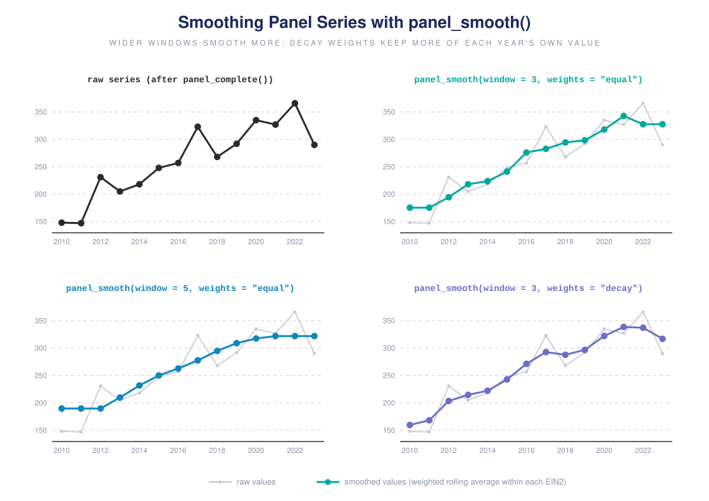

```{r, include = FALSE}
knitr::opts_chunk$set(collapse = TRUE, comment = "#>")
library(panel990)
```

`panel_smooth()` replaces a numeric field with a rolling weighted average taken
*within each organization*, ordered by year. It dampens year-to-year noise
(reporting quirks, one-off spikes) while leaving the rows in place.

A single organization with a one-year spike:

```{r}
df <- data.frame(
  EIN2     = "A",
  TAX_YEAR = 2016:2022,
  revenue  = c(10, 12, 11, 50, 13, 12, 11)   # spike in 2019
)
```

## Window and weights

`window` is the (odd) number of years averaged; `weights` decides how much each
year in the window counts:

- **`equal`** -- a plain moving average; every year in the window counts the same.
- **`half`** -- the focal year gets half the weight, the neighbours share the other half.
- **`decay`** -- weight falls by half per year of distance (`0.5^distance`).

{width=100%}

```{r}
w <- function(wt) panel_smooth(df, "revenue", window = 3, weights = wt,
                               verbose = FALSE)$revenue
data.frame(
  year    = df$TAX_YEAR,
  raw     = df$revenue,
  equal   = round(w("equal"), 1),
  half    = round(w("half"), 1),
  decay   = round(w("decay"), 1)
)
```

Notice 2019: `equal` pulls the spike down hardest (it treats the neighbours and
the spike alike), while `half` and `decay` keep more of the focal value. (For a
centred width-3 window `half` and `decay` give identical weights; they differ at
the series edges, where the window is off-centre, and more visibly from
`window = 5` on, where `decay` down-weights distant years more steeply.)

A wider window smooths more aggressively:

```{r}
data.frame(
  year = df$TAX_YEAR,
  w3   = round(panel_smooth(df, "revenue", window = 3, verbose = FALSE)$revenue, 1),
  w5   = round(panel_smooth(df, "revenue", window = 5, verbose = FALSE)$revenue, 1)
)
```

## Centred, trailing, and forward windows

By default the window is centred on each year, so the smoothed value for year
`t` borrows from `t + 1`. That is fine for description, but it leaks the future
into the past -- a problem whenever the smoothed series is used as a baseline
or covariate before some event. `align` controls where the window sits:

- **`"center"`** (default) -- the `window` *rows* centred on the focal row.
- **`"right"`** -- a trailing window: calendar years `t - (window - 1)` through
  `t`. No value after `t` is ever used.
- **`"left"`** -- the forward-looking mirror: years `t` through
  `t + (window - 1)`.

The trailing and forward windows count calendar years, not rows, so a filing
gap is never bridged. Here 2017--2018 are missing:

```{r}
gappy <- data.frame(
  EIN2     = "A",
  TAX_YEAR = c(2015, 2016, 2019, 2020, 2021),
  revenue  = c(10, 20, 30, 40, 50)
)
a <- function(al) panel_smooth(gappy, "revenue", window = 3, align = al,
                               verbose = FALSE)$revenue
data.frame(year = gappy$TAX_YEAR, raw = gappy$revenue,
           center = a("center"), right = a("right"), left = a("left"))
```

The centred 2019 value averages 2016, 2019, and 2020 -- three rows spanning
five years. The trailing 2019 value uses 2019 alone, because 2017 and 2018 were
not filed and 2016 is outside the three-year window. Early years in a trailing
window (and late years in a forward one) simply use the part of the window that
is observed. Off-centre windows may also be even (`window = 2`).

`weights` work the same way, with distance counted in calendar years:
`decay` gives `0.5^(t - year)` and `half` puts 0.5 on the current year. The
trade-off is lag: a trailing window spreads a real change over `window` years.

## Edges, gaps, and multiple series

With `align = "center"`, at the ends of a series the fixed-width window slides inward rather than
shrinking, and organizations with fewer years than `window` use a smaller
effective window. Missing values (`NA`/`NaN`) are dropped from each window and
the remaining weights are renormalized, so a stray gap does not blank out its
neighbours; a window with nothing observed returns `NA`.

`panel_smooth()` handles many organizations and several fields at once, always
smoothing each organization independently and returning the rows in their
original order:

```{r}
panel <- data.frame(
  EIN2     = rep(c("A", "B"), each = 4),
  TAX_YEAR = rep(2019:2022, 2),
  revenue  = c(100, 300, 200, 400,  50, 40, 90, 60),
  expenses = c(90,  250, 180, 350,  45, 35, 80, 55)
)
head(panel_smooth(panel, vars = c("revenue", "expenses"),
                  window = 3, verbose = FALSE), 4)
```

Smoothing changes values but never the shape of the data -- same rows, same
order, selected columns replaced by their smoothed versions.
